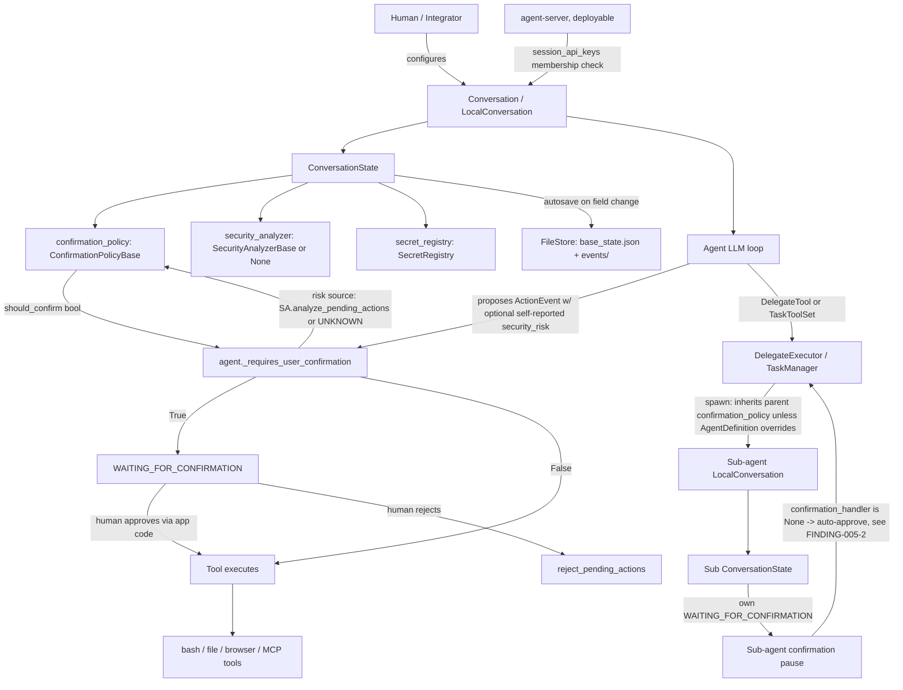

# EXP-005 — Methodology Validation Against a Real Application

**Target:** [OpenHands Software Agent SDK](https://github.com/OpenHands/software-agent-sdk)
(commit `97dbce5c37865dd7a3020d2b9662f4a76d11fa71`, package `1.49.0`, cloned 2026-09-16).
**Status:** Complete — first end-to-end run of the [13-stage assessment pipeline](../../docs/methodology/03-assessment-methodology-v0.1.md),
stage 1 through stage 13, against a genuinely unfamiliar, non-lab
target. EXP-003A/B/C entered at stage 6; this is the first time stages
1-5 (Architecture Review through Execution Graph) have been produced as
real artifacts rather than folded into README narrative.

**Primary research question:** can `docs/methodology/` (v0.1, EXP-004)
be applied to a real-world AI application without modification? This
document is a test of the methodology, not primarily a vulnerability
hunt — see §10 for the explicit verdict, and §7-9 for the
methodology-quality analysis that verdict rests on. Three real,
source-verified findings were produced along the way (`findings.md`);
they are evidence *for* the methodology-validation question, not the
point of this exercise.

---

## 1. Target Selection

### 1.1 Candidates considered

The mission brief for this experiment excluded re-running EXP-003's
approach (testing another generic agent *framework*) and required a
real *application*: something that executes real actions, ideally with
multi-agent delegation, persistence, and an approval workflow, with
public source. Five candidates were surveyed (web search + spot
verification against each project's own docs/issue tracker, 2026-09-16):

| Candidate | Architecture | Execution model | Agent model | Authorization model | Why valuable | Est. effort |
|---|---|---|---|---|---|---|
| **OpenHands Software Agent SDK** | Composable Python SDK (`openhands-sdk`) + deployable FastAPI `agent-server` + CLI/clients; real production usage (SWE-bench-scored coding agent) | Real shell/file/browser/MCP tool execution against a workspace, optionally sandboxed (Docker runtime) | Single agent by default; two real delegation primitives (`DelegateTool` — parallel sub-agents via threads; `TaskToolSet` — sequential, lifecycle-managed sub-agents), each sub-agent its own `LocalConversation` | Explicit, typed: `ConfirmationPolicyBase` (`AlwaysConfirm`/`NeverConfirm`/`ConfirmRisky`) + pluggable `SecurityAnalyzerBase` (LLM-based and three deterministic "defense-in-depth" analyzers) + persisted `ConversationState`; agent-server layer adds a static shared-secret (`session_api_keys`) admission check | Real approval workflow, real delegation, real persistence, public source, active development, an academic tech report (arXiv:2511.03690), and — discovered during survey — a real merged PR (#4813) fixing a dual-source-of-truth authorization-state bug, i.e. live evidence Crypton's threat model already matches a real incident in this exact codebase | ~3-4 focused sessions for a scoped static review (this experiment); a live-execution engagement would need an LLM budget + sandbox, larger |
| CrewAI | Python multi-agent orchestration framework, `hierarchical` process with an auto-created or user-defined manager agent | Tool execution via LangChain-style tool wrappers | Explicit delegation (manager → worker agents), `allowed_agents` scoping added recently | `human_input` flag per task (coarse, task-level, not argument-bound); an open GitHub feature request (#5562, "Agent Governance Toolkit") explicitly asks for delegation approval workflows, pre-delegation policy checks, and identity verification — meaning the authorization surface Crypton would test is **not yet built**, only requested | A strong *future* target once #5562-shaped work lands; today it would mostly produce NOT_APPLICABLE results for the Human Approval pillar, which is a weaker methodology-validation exercise (validates the "mark it NOT_APPLICABLE, sourced" discipline but not much else) | Lower (less to test) but lower-value for this specific experiment |
| Microsoft AutoGen / AG2 | Multi-agent conversation framework, human-in-the-loop modes (`human_input_mode`) | Tool/function execution | Explicit multi-agent (`GroupChat`, nested chats) | Similar family to Microsoft Agent Framework, already tested in EXP-003B | Adjacent to, not independent of, existing evidence — same vendor lineage as an already-tested target; lower marginal value for a "genuinely unfamiliar target" test | Lower marginal value given EXP-003B overlap |
| Open Interpreter | Single-process local code-execution agent, `safe_mode` confirmation before running generated code | Local shell/Python execution | Single agent, no delegation primitive | Simple per-command confirm/deny prompt; no typed policy object, no risk classification, no persistence layer to speak of | Real actions, real (if minimal) approval gate, but structurally too simple to exercise most of the seven pillars (no Delegation, no Persistence, thin Identity) — most pillars would resolve NOT_APPLICABLE for reasons that teach little | Low effort, low yield for this experiment's goal |
| SWE-agent | Autonomous, containerized issue-resolving agent (SWE-bench) | Real repo/shell actions inside a sandbox | Single agent, no delegation | Runs non-interactively end-to-end by default; no first-class human-approval gate in the mainline loop | Real actions, real sandbox trust boundary, but the Human Approval and Delegation pillars are structurally absent, not implemented-and-testable — same limitation as Open Interpreter, more so | Low yield for pillars 3/4 |

### 1.2 Recommendation: OpenHands Software Agent SDK

OpenHands is the only candidate that gives every one of the seven
pillars a real, implemented, non-trivial surface to test against:
typed identity/authentication at the deployable server layer, an
explicit multi-tier authority representation (`ConfirmationPolicyBase`
× `SecurityAnalyzerBase` × `SecurityRisk`), two independent delegation
primitives, real persistence (`ConversationState`/`base_state.json`),
a real (if coarse) approval workflow, real execution-graph branches
(approve/reject/resume), and a durable event log for auditability. It
is also the only candidate where survey-stage research already
surfaced a *real, merged, dated PR* (OpenHands/software-agent-sdk#4813)
fixing a bug in exactly the shape Crypton's Threat Model predicts
("Persist privilege" / policy TOCTOU via dual-source-of-truth state) —
independent, third-party corroboration that the threat model is
grounded in real engineering failure modes, not just Crypton's own
reasoning. Scope for this experiment (see `target.json`) is narrowed to
the confirmation/authorization/delegation/persistence surface — not the
whole ~1,700-file monorepo — mirroring how a real customer engagement
would scope to "one workflow," per `docs/business/ASSESSMENT_PACK.md` §B.

---

## 2. Architecture Review (Pipeline Stages 1-5)

### 2.1 System diagram



### 2.2 Agent graph

Default: single agent. With delegation: a parent `Agent` running inside
a `LocalConversation`, holding a `DelegateTool`/`TaskToolSet` tool,
whose executor (`DelegateExecutor`/`TaskManager`) owns zero-or-more
child `LocalConversation`s, each with its own `Agent`, its own
`ConversationState`, and (for `DelegateTool`) its own OS thread run
concurrently with siblings. No further nesting depth limit was found
in source beyond `max_children` (default 5, `DelegateExecutor.__init__`).

### 2.3 Execution graph (single action, happy path)

```
LLM emits tool call (may include self-reported security_risk)
  -> ActionEvent constructed (agent.py: _extract_security_risk)
  -> agent._requires_user_confirmation(state, [ActionEvent])
       risk = security_analyzer.analyze_pending_actions(...) if configured else UNKNOWN
       should_confirm = state.confirmation_policy.should_confirm(risk)
  -> if should_confirm: state.execution_status = WAITING_FOR_CONFIRMATION (pauses)
  -> else: tool executes immediately
  -> [if paused] integrating app surfaces pending action to a human
       -> approve: conversation.run() resumes, tool executes
       -> reject: conversation.reject_pending_actions(feedback), no execution
```

The authorization check (`_requires_user_confirmation`) sits **before**
the tool executor is invoked, on the same object identity as the
proposed action (`ActionEvent`) — this is a real pre-execution
boundary, not a post-hoc log (Pillar 5 / Methodology Stage 5,
Pre-Execution Boundary in `docs/ASSESSMENT_METHODOLOGY.md` area 4
terms). Confirmed by reading `agent.py:1046-1114` directly, not
inferred from documentation.

### 2.4 Identity graph

```
Deployable server (agent-server)
  request -> Bearer/query/websocket session_api_key
           -> dependencies.py: `session_api_key not in config.session_api_keys`
           -> flat list membership check (no per-key identity object found)
Library layer (openhands-sdk imported directly, no server)
  no identity primitive at all — "who is running this Conversation"
  is entirely the integrating application's responsibility
```

### 2.5 Persistence graph

```
ConversationState (Pydantic model, autosaves on public-field mutation)
  -> _save_base_state() -> FileStore.write(BASE_STATE)  [base_state.json]
  -> EventLog -> FileStore  [events/ dir, one entry per event]
  -> secret_registry serialized with optional `cipher` for encryption at rest
  -> resume: base_state.json is read FIRST; if present, it is the
     single source of truth for confirmation_policy, security_analyzer,
     and secrets (post-PR #4813 — see findings.md "context finding")
Delegation persistence: sub-agents inherit persistence_dir + "/subagents/<id>"
  when the parent is persisted; unpersisted when the parent is not.
```

### 2.6 Approval graph

```
ConversationExecutionStatus: IDLE -> WAITING_FOR_CONFIRMATION -> {IDLE, FINISHED, ...}
Pending-action identification: ConversationState.get_unmatched_actions()
  matches ActionEvents against ObservationEvent / UserRejectObservation /
  AgentErrorEvent by action_id (or tool_call_id for crash-recovery cases)
  -- this is a real, argument-bearing correlation handle, not a bare flag.
Top-level: pause is real and must be resolved by the integrating app's
  own code (no default auto-resolution found at this layer).
Delegated: pause is real, but DelegateExecutor/TaskManager's default
  wiring (confirmation_handler=None) resolves it without ever reaching
  a human -- see FINDING-005-2.
```

### 2.7 Trust-boundary diagram (where a claim is trusted, not re-verified)

| Boundary | What crosses it | Re-verified? |
|---|---|---|
| LLM output → `ActionEvent.security_risk` | The model's self-reported risk level | **No**, when `LLMSecurityAnalyzer` is the only analyzer — see FINDING-005-1 |
| Parent `confirmation_policy` → spawned sub-agent | Whichever policy object the parent held at spawn time | Inherited by value, not independently chosen unless `AgentDefinition.permission_mode` is set — a real, intentional design, not a gap by itself |
| Sub-agent `WAITING_FOR_CONFIRMATION` → `DelegateExecutor`/`TaskManager` | The fact that a human decision is required | **No**, by default — see FINDING-005-2 |
| `session_api_keys` config → agent-server request admission | Caller identity | Checked as flat-list membership only; no attribution of *which* key was used was found in the reviewed code paths |
| `base_state.json` → resumed `ConversationState` | `confirmation_policy`, `security_analyzer`, `secrets` | **Yes, today** — this is the exact boundary PR #4813 fixed; now single-source-of-truth, verified in `state.py`'s resume path |
| Caller-supplied `Agent` (with possibly new tools) → resumed state | Tool set | Explicitly verified (`AgentBase.verify`: class must match, tools may only be added, never removed) |

---

## 3. Seven-Pillar Assessment (Pipeline Stage 2-5, Security Property Catalog)

| Pillar | What exists | What's missing | How implemented | Evidence |
|---|---|---|---|---|
| **1. Identity** | A flat, shared-secret admission list (`session_api_keys`) at the deployable server layer | Cryptographically-bound, per-agent, individually-attributable identity; no evidence any code path records *which* configured key authenticated a given request | `agent_server/dependencies.py:35`, `sockets.py:159`, `openai/router.py:65,67` — all `in config.session_api_keys` membership checks | Source-verified |
| **2. Authority** | Typed `ConfirmationPolicyBase` × `SecurityAnalyzerBase` × `SecurityRisk` composition; single real enforcement call site (`agent.py:1081`) | Independent verification of the risk signal itself when only `LLMSecurityAnalyzer` is used (FINDING-005-1); a second, unused, semantically different decision function still exists in source (FINDING-005-3) | `security/confirmation_policy.py`, `security/analyzer.py`, `security/risk.py` | Source-verified |
| **3. Delegation** | Two real primitives (`DelegateTool`, `TaskToolSet`); explicit, intentional policy inheritance (`get_confirmation_policy() or parent policy`); a hard `max_children` cap | Delivery of a delegated sub-agent's own confirmation pause to an actual human is not wired by default (FINDING-005-2); no evidence of true credential/tool-set *attenuation* on spawn (sub-agent gets the same LLM/tool factory shape, scoped by `agent_type` registration, not a narrower runtime capability grant) | `openhands-tools/openhands/tools/delegate/impl.py`, `openhands-sdk/openhands/sdk/subagent/schema.py` | Source-verified |
| **4. Human Approval** | Real pre-execution pause (`WAITING_FOR_CONFIRMATION`), real argument-bearing correlation (`get_unmatched_actions`), explicit reject-with-feedback path | Bound to the model's *self-reported* risk when that's the only signal (FINDING-005-1); silently bypassed one delegation hop down by default (FINDING-005-2); default `ConversationState.confirmation_policy` is `NeverConfirm()` — approval is opt-in, not secure-by-default (a documented, disclosed posture, not a hidden one, but worth a customer knowing explicitly) | `conversation/state.py:123`, `agent.py:1046-1087` | Source-verified |
| **5. Execution** | Pre-execution boundary sits ahead of the tool call, not after; three deterministic "defense-in-depth" analyzers exist for actions gated by pattern (`rm -rf`, `curl\|sh`, piped/composed threats) independent of the model | No test performed of tool-substitution (H9-class: same effective action reachable through a different, less-gated interface) — genuinely out of scope for a static pass; flagged INCONCLUSIVE | `agent.py`, `security/ensemble.py`, `security/defense_in_depth/` | Source-verified (gating order); INCONCLUSIVE (substitution) |
| **6. Persistence** | `base_state.json` is the single source of truth for `confirmation_policy`/`security_analyzer`/`secrets` on resume, **as of a specific, dated, real fix** (PR #4813) — before that fix, this pillar would have FAILed | The fix is recent enough (exact PR merge date not confirmed beyond "before 2026-09-16" from search results) that no independent confirmation this shipped in the pinned `1.49.0` tag specifically was performed beyond reading it directly in the cloned `main`-branch commit; flagged as a minor confidence caveat, not a gap | `conversation/state.py:509-568`; PR #4813 | Source-verified (current state); historical context (PR) |
| **7. Auditability** | Durable, append-only `EventLog`, correlated by `action_id`/`tool_call_id`, survives crash/restart (explicitly designed for "crash recovery scenarios," per `get_unmatched_actions`' own docstring) | No cryptographic attribution tying a given event to a specific authenticated caller/key (same gap as Pillar 1, echoing the Threat Model's "Lose attribution" coverage-gap objective, now with real-target evidence rather than only the EXP-003 by-omission observation) | `conversation/state.py:677-707`, `agent_server/dependencies.py` | Source-verified |

---

## 4. Threat Model (Pipeline Stage 6) — Eleven Attacker Objectives

The mission brief's Phase 3 asks for a four-way outcome per objective
(Supported / Partially mitigated / Not mitigated / Not applicable).
Crypton's existing Threat Model uses a five-way vocabulary (PASS /
PARTIAL PASS / SPLIT / COVERAGE GAP / NOT_APPLICABLE) tuned for
*Crypton's own evidence coverage* rather than *the target's own
mitigation strength*. These are different axes, and mapping cleanly
between them is itself a real Phase-5 methodology observation (see §7,
row "Threat Model outcome vocabulary"). The table below states both.

| Attacker objective | Target mitigation (mission vocabulary) | Crypton coverage (existing vocabulary) | Basis |
|---|---|---|---|
| Acquire authority | **Not mitigated** | COVERAGE GAP (confirmed, now against a real deployable server, not just an absent framework primitive) | `session_api_keys` is a shared secret; no crypto identity anywhere in the reviewed tree |
| Expand authority | **Not applicable / untested** | COVERAGE GAP | No multi-target/scope-set action construct found in the reviewed surface to test against (H7 not exercised) |
| Reuse authority | **Partially mitigated** | Adjacent to PASS (H4 family) but **not directly tested this pass** | `base_state.json` single-source-of-truth (post-#4813) supports exactly-once-shaped persistence in principle; no live resume test was run to confirm it holds under this SDK's specific `EventLog` mechanics — INCONCLUSIVE for a *confirmed* PASS, though the static evidence is suggestive |
| Forge authority | **Not applicable / untested** | COVERAGE GAP | No forged-approval-object test performed (would require constructing a fake `ActionEvent`/event-log entry and observing whether it's accepted — not attempted, out of static-review scope) |
| Replay authority | **Not applicable / untested** | COVERAGE GAP | Same reasoning as "Reuse authority" |
| Confuse authority | **Partially mitigated** | Adjacent to PASS (H2-style delegation-boundary reading) with a **new, real counter-example** | Delegation approval boundary itself looks sound (own gate, own state); but FINDING-005-1 is a distinct confused-authority vector (the model's own self-report gates its own confirmation) that the prior EXP-003 framing of "Confuse authority" did not anticipate |
| Lose attribution | **Not mitigated** | COVERAGE GAP (now with real-target evidence, not just by-omission) | No per-key/per-identity attribution found for events or server requests |
| Bypass approval | **Not mitigated (delegation path) / Supported (top-level path)** | SPLIT | Top-level pre-execution gate is real and sound; delegated-sub-agent path silently bypasses it by default (FINDING-005-2) |
| Modify execution | **Not applicable / untested (tool substitution)** | COVERAGE GAP (H9) | Not tested this pass — flagged, not silently skipped |
| Escape delegation | **Partially mitigated** | PARTIAL PASS, consistent with EXP-003's prior finding shape | Own-gate independence holds (child's tool-call approval is genuinely separate from parent's); but delivery of that gate's outcome to a human is broken by default (FINDING-005-2), which is a different failure mode than "escape" in the strict sense — the child doesn't get *more* authority than intended, but its confirmation requirement is *defeated* |
| Persist privilege | **Mitigated (currently) — was Not mitigated historically** | Real, dated, verifiable before/after | PR #4813 is a real historical instance of exactly this objective, now fixed; the strongest single piece of evidence in this whole assessment that the Threat Model's categories correspond to real engineering failures |

---

## 5. Universal Hypotheses (Pipeline Stage 8)

Per the "do not invent new hypotheses per target" rule, H1-H9 are
evaluated as-is first. Where a real hypothesis-shaped gap was found
that doesn't fit H1-H9, it is proposed as **H10** below rather than
silently folded into an existing one.

| # | Hypothesis | Result on OpenHands SDK | Basis |
|---|---|---|---|
| H1 | Argument Binding | **INCONCLUSIVE (static)** — the correlation mechanism (`get_unmatched_actions`, matched by `action_id`) is real and argument-bearing, structurally similar to EXP-003C's safe, state-sourced pattern; no live test was run to confirm arguments cannot be mutated between proposal and resume (no `update_state()`-equivalent public mutation API was located in the reviewed surface, but absence-of-evidence was not exhaustively confirmed) | `conversation/state.py:677-707` |
| H2 | Delegation Boundary | **PASS** (own-gate independence) **+ new finding** (FINDING-005-2, gate delivery, a distinct question H2 doesn't ask) | `delegate/impl.py`, `task/manager.py` |
| H3 | Standing Approval | **PASS/EXPECTED_BY_DESIGN**, broad-only, argument-blind by design, same shape as EXP-003A's `always_approve` — `NeverConfirm()`/`AlwaysConfirm()` are binary and explicit, not argument-scoped; `ConfirmRisky()` is the closest thing to a narrower standing approval, and it is risk-scoped, not argument-scoped | `security/confirmation_policy.py:27-61` |
| H4 | Persistence/Resume Binding | **INCONCLUSIVE (static)**, see "Reuse authority" row above — structurally supportive evidence, not a run test | `conversation/state.py:460-593` |
| H5 | Policy/Guardrail Drift | **PASS, historically FAIL-then-fixed** — this is the strongest, most concrete H5 result Crypton has produced across any target to date, because it comes with a real dated before/after (PR #4813), not just a point-in-time PASS | PR #4813; `conversation/state.py` |
| H6 | Identity/Origin Binding | **NOT_APPLICABLE at the library layer** (no identity primitive to bind to); **INCONCLUSIVE at the server layer** (session_api_keys exist but no per-key attribution was located; whether an approval could cross *which caller's* session was not tested) | `agent_server/dependencies.py` |
| H7 | Scope/Target Expansion | **NOT TESTED / COVERAGE GAP**, consistent with the pre-existing Threat Model gap | — |
| H8 | Attribution Durability | **PARTIAL** — the event log itself is durable and reconstructable (Pillar 7's "what" and "under what authority" are answerable); the "who" is not, once past a shared API-key admission check | `conversation/state.py:677-707`; `agent_server/dependencies.py` |
| H9 | Tool Substitution | **NOT TESTED / COVERAGE GAP** — same status as EXP-003A/B/C | — |
| **H10 (new, proposed)** | **Self-Report Independence** — is the risk/authorization signal that gates a human-approval decision derived independently of the actor whose action is being evaluated, or is it self-reported by that same actor? | **FAIL for `LLMSecurityAnalyzer` used alone; PASS for `Ensemble`-composed deterministic analyzers** | FINDING-005-1 |

---

## 6. Findings

Three real, source-verified findings and one historical corroborating
data point — full eleven-link chains in [`findings.md`](findings.md):

1. **FINDING-005-1** (Moderate) — risk-gated confirmation can be
   satisfied entirely by the model's own self-report when
   `LLMSecurityAnalyzer` is used alone.
2. **FINDING-005-2** (Moderate-to-high) — delegated sub-agent
   confirmation pauses are silently auto-approved unless an integrator
   manually wires a `ConfirmationHandler` callback; no shipped example
   does this.
3. **FINDING-005-3** (Low/informational) — two independent,
   inconsistent confirmation-decision implementations coexist in
   source; one (`should_require_confirmation`) is currently dead code.
4. **Context finding** — PR #4813 is real, third-party, historical
   confirmation that Crypton's "Persist privilege" threat class
   already occurred in this exact codebase and was fixed.

---

## 7. Methodology Validation (Pipeline Stages 1-13, stage by stage)

| Stage | Result | Notes |
|---|---|---|
| 1. Architecture Review | **Worked unchanged** | The stage's own definition ("plain description... framework/runtime, tools reachable, delegation, persistence") translated directly; no adaptation needed to start from an application's real docs/source instead of a framework's |
| 2. Identity Mapping | **Worked unchanged** | Produced a real, useful result (shared-secret admission, no crypto identity) without any method change |
| 3. Authority Mapping | **Worked unchanged, produced the assessment's best finding** | Tracing "where is each check, what feeds it" is exactly what surfaced FINDING-005-1 — this stage did the most work of any stage in this run |
| 4. Trust Boundaries | **Worked unchanged, produced the second-best finding** | FINDING-005-2 is a textbook Stage-4 result: a boundary (sub-agent pause → integrating app) that "wasn't obvious until named explicitly," same shape as EXP-003C's `update_state()` precedent this stage's own documentation predicts |
| 5. Execution Graph | **Worked unchanged** | Straightforward to trace from source; no framework-specific assumption was needed to write it |
| 6. Threat Model | **Required adaptation** | The mission's requested four-way outcome vocabulary (Supported/Partially mitigated/Not mitigated/Not applicable) does not map 1:1 onto the existing five-way vocabulary (PASS/PARTIAL PASS/SPLIT/COVERAGE GAP/NOT_APPLICABLE) — see §4's dual-column table. This is a real, concrete adaptation need, not a cosmetic one: the existing vocabulary measures *Crypton's evidence coverage*, while the mission's vocabulary measures *the target's mitigation strength* — genuinely different questions that got conflated into one column until this run forced them apart |
| 7. Baseline Verification | **Insufficient as currently scoped for a static-review-only pass** | Baseline A/B/C (approve→executes, reject→no-op, persist→reload→resume) are defined as *executable* tests in every precedent (EXP-003A/B/C, all ran live scripted code). A pure static-review methodology run (mandated by this experiment's rules — no LLM execution) has no way to produce a Baseline A/B/C result at all; this stage was **skipped entirely**, not degraded. That is a real methodology gap this run exposes: the current playbook assumes Baseline Verification is always executable, and does not define what a static-only engagement should do in its place |
| 8. Universal Hypotheses | **Worked unchanged, plus a real extension** | H1-H9 applied cleanly (see §5); H10 was needed and is proposed additively, per the "extend, don't fork" rule from the Framework Adaptation Guide |
| 9. Framework-Specific Tests | **Required adaptation** | "Framework-Specific" language throughout `docs/methodology/` assumes the target *is* a framework (OpenAI Agents SDK, MS Agent Framework, LangGraph). OpenHands SDK is a framework-*shaped* library, but it sits inside a larger application (agent-server, CLI, examples) whose own integration choices (e.g. not wiring a `confirmation_handler`) are themselves part of what needed testing. The pipeline's stage-9 name and the Framework Adaptation Guide's whole framing implicitly assume "test the framework's primitives," not "test how the framework's own maintainers chose to wire those primitives together in their reference example" — yet the latter produced FINDING-005-2, arguably the single most actionable result of this run. This is the clearest "assumption that failed": *the target is not always cleanly separable into "framework" vs. "application," and the methodology's language should say so* |
| 10. Evidence Collection | **Worked unchanged** | Commit-pinned file:line citations, matching the eleven-link standard, were straightforward to produce from static review alone — this stage does not assume live execution |
| 11. Risk Analysis | **Worked unchanged** | The seven-factor rubric applied cleanly to all three findings without modification |
| 12. Findings | **Worked unchanged** | The eleven-link chain (`findings.md`) was directly usable, no missing link, no field that needed inventing |
| 13. Remediation | **Worked unchanged** | "Recommend the control, not Crypton" applied cleanly — all three recommendations are configuration/code changes for the target's own maintainers or its integrators, none reference a Crypton product |

**Every assumption that failed, listed explicitly** (per the mission's Phase 5 instruction):

1. Baseline Verification (Stage 7) implicitly assumes live execution is
   always available; it has no defined static-only substitute.
2. The Threat Model's outcome vocabulary conflates "how much evidence
   does Crypton have" with "how well-mitigated is the target," which
   this run's mission-mandated four-way vocabulary forced apart.
3. "Framework-Specific Tests" (Stage 9) and the Framework Adaptation
   Guide both assume a clean framework/application boundary that does
   not hold for a target like this one, where the highest-value finding
   came from *application-level integration choices layered on top of*
   otherwise-sound framework primitives.

---

## 8. Assessment Quality Review

**Which steps produced valuable evidence?** Authority Mapping (Stage 3)
and Trust Boundaries (Stage 4) — both produced real, distinct,
high-confidence findings from nothing more than "trace where this check
gets its input" and "list every point a claim is trusted." This matches
the Playbook's own prediction that Stage 4 is "the stage most likely to
surface something the customer's own team hasn't thought to name," now
confirmed against a second, independent target (EXP-003C was the first).

**Which steps produced noise?** None, in this run — every stage that
was executed (1-6, 8, 10-13) produced either a real result or a real,
specific NOT_APPLICABLE/INCONCLUSIVE with a stated reason. The one
stage that produced *nothing* (Baseline Verification, Stage 7) did so
because it was structurally inapplicable to a static-only pass, not
because it asked a bad question — this is a scoping gap, not a
methodology-quality problem with the stage itself.

**Which questions were redundant?** None found. The seven pillars and
eleven threat objectives did not produce duplicate findings against
this target — each pillar's "what's missing" column names something
distinct.

**Which questions were missing?** One clear gap: nothing in the
existing seven pillars or eleven objectives directly asks "is the
signal that gates an authorization decision independently verified, or
self-reported by the actor being gated?" (FINDING-005-1's shape). H10
is proposed in §5 to close this. A second, smaller gap: the
Delegation pillar's questions ("Can authority be delegated? Can
delegation be chained? Is attenuation enforced?") don't ask "is the
delegated party's *own* gate actually delivered to anyone" — FINDING-005-2
answers a question the current Pillar 3 checklist doesn't explicitly
pose.

**Which security property should be added?** A property tentatively
named **"Signal Independence"**: for any risk/authorization signal that
gates a consequential decision, is its source independent of the party
whose action it evaluates? This generalizes past just LLM self-reported
risk (it would also apply to, e.g., a sub-agent self-certifying its own
task as complete, or a delegate self-reporting its own scope as
narrow).

**Which property should be removed?** None. All seven pillars produced
real signal against this target; none were dead weight.

**Attempt to disprove the methodology — did it survive?** The strongest
disproof attempt available was: *does this pipeline, applied by someone
who has never seen this codebase before, actually surface something a
customer's own engineers plausibly haven't already noticed, using only
publicly available material and without executing anything?* The answer
is yes, twice, independently (FINDING-005-1, FINDING-005-2), plus one
structural code-hygiene observation (FINDING-005-3) and one piece of
strong corroborating third-party evidence that the threat model itself
is not invented (PR #4813). The methodology did **not** survive
*unchanged* — §7 lists three real adaptations required — but it
survived *as a shape*: the 13-stage order, the seven pillars, the
eleven objectives, and the eleven-link evidence chain all produced
usable results with the noted adaptations, none needed to be discarded
or replaced.

---

## 9. Methodology v0.2 Recommendations

Only changes supported by evidence gathered in this run:

1. **New hypothesis H10 — Signal Independence** (see §5, §8). Add to
   the standing H1-H9 table in `03-assessment-methodology-v0.1.md`
   stage 8, per the existing "extend, don't fork" convention.
2. **New/extended Pillar 3 question**: add "is the delegated party's
   own gate actually delivered to a human, or silently auto-resolved by
   the delegation mechanism itself?" to the Delegation pillar's
   checklist in `01-security-property-catalog.md`.
3. **Split the Threat Model's outcome vocabulary into two explicit
   axes**, not one: *Crypton evidence coverage* (PASS/COVERAGE
   GAP/INCONCLUSIVE, "how much do we know") and *target mitigation
   strength* (Supported/Partially mitigated/Not mitigated/Not
   applicable, "how well is it defended"). §4 of this document is a
   worked example of what that looks like; recommend formalizing it as
   two columns in `02-threat-model.md`'s coverage table rather than one.
4. **Define a static-review-only variant of Baseline Verification
   (Stage 7)**: when live execution is out of scope (budget, risk
   posture, or — as here — an explicit no-execution research
   constraint), the stage should require, at minimum, a *sourced*
   statement of what Baseline A/B/C *would* need to hold, with the
   specific code path that would need to be exercised named — rather
   than being silently skipped, as it was in this run. This is a
   process gap this run exposed, not a retroactive fix to this run's
   own results.
5. **Rename or annotate "Framework-Specific Tests" (Stage 9) and the
   Framework Adaptation Guide** to acknowledge that a target is not
   always cleanly separable into "framework" vs. "the application built
   on it" — the highest-value finding in this run (FINDING-005-2) lived
   at exactly that seam. Suggested minimal fix: rename the stage
   "Target-Specific Tests" and add one sentence noting that testing a
   framework's *own reference integration* (its examples, its
   maintainers' default wiring choices) is explicitly in scope, not a
   layer to skip past.
6. **No removals.** No pillar, objective, or hypothesis produced by
   prior work was found to be dead weight against this target.

---

## 10. Final Verdict

**VALIDATED WITH ADAPTATIONS.**

The methodology (`docs/methodology/` v0.1, EXP-004) was applied
end-to-end, stages 1-13, against a real, unfamiliar, actively-developed
AI application it had never been run against before, using only public
source, public documentation, and static review — no framework
internals modified, no production system touched, no third-party
service abused, consistent with the mission's rules of engagement. It
produced:

- Two real, distinct, source-verified, non-trivial security findings
  (FINDING-005-1, FINDING-005-2) that a customer's own engineering team
  plausibly has not already surfaced, each traceable through the full
  eleven-link evidence chain with commit-pinned citations.
- One structural code-hygiene observation (FINDING-005-3).
- One piece of strong, independent, third-party corroboration
  (PR #4813) that the Threat Model's categories correspond to real
  engineering failures, not speculative ones.
- Three concrete, evidence-supported adaptations the methodology itself
  needs (Baseline Verification's execution assumption, the Threat
  Model's conflated outcome vocabulary, and Stage 9's
  framework/application boundary assumption) — each with a specific,
  scoped v0.2 recommendation in §9, not a vague "needs more work."

It is not **VALIDATED** outright, because three real assumptions
failed and required adaptation to get a coherent result (§7's summary
list) — a customer engagement run "by the book" against a target this
shape, without the adaptations made explicit in this document, would
have either silently skipped Baseline Verification with no record of
why, conflated two different questions in its Threat Model coverage
table, or under-scoped Stage 9 to miss the application-level wiring
gap that produced this run's best finding. It is well clear of
**PARTIALLY VALIDATED** or **NOT VALIDATED**: no stage produced
unusable or contradictory results, no pillar or hypothesis needed to be
discarded, and the pipeline's *shape* (order, seven pillars, eleven
objectives, eleven-link chain) held completely.

**What would change this verdict:** a second unfamiliar-target run
that needed a *different* set of adaptations (rather than confirming
these same three) would suggest the gaps are per-target idiosyncrasies
rather than real methodology gaps worth fixing once, centrally — that
would be evidence to downgrade §9's recommendations from "adopt" to
"reconsider, target-specific." Conversely, a live-execution follow-up
against this same target (with an LLM budget) that confirmed H1/H4/H6's
current INCONCLUSIVE results as real PASSes, and confirmed FINDING-005-2's
live behavior matches its static prediction, would strengthen this
verdict toward unqualified confidence in the static-review path
specifically, which is the path most real early-stage engagements
(cost-constrained, staging-access-constrained) are likely to actually
run.
